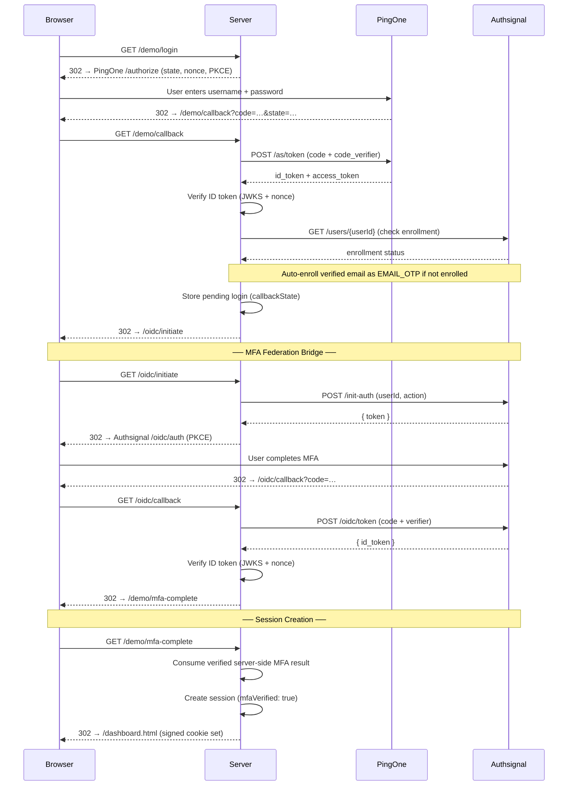

# Authsignal + PingOne Integration

Add Authsignal MFA and passwordless authentication to PingOne (Ping Identity) login flows.

## What This Does

This integration adds **Authsignal's MFA and passwordless capabilities** to **PingOne** authentication flows. A customer-deployed server sits between PingOne (identity provider) and Authsignal (MFA orchestrator) — PingOne handles "who are you?" and Authsignal handles "prove it's really you."

```
┌──────────┐      ┌──────────────┐      ┌─────────────┐      ┌─────────────┐
│  Browser  │ ──── │  Customer     │ ──── │   PingOne    │      │  Authsignal  │
│           │      │  Server       │ ──── │  (Identity)  │      │  (MFA)       │
└──────────┘      └──────────────┘      └─────────────┘      └─────────────┘
```

### Supported Authentication Methods

- Email OTP (auto-enrolled from PingOne email)
- Passkeys (FIDO2 WebAuthn)
- SMS OTP
- TOTP (authenticator apps)
- Push notifications
- WhatsApp OTP

## Integration Patterns

### MFA Federation Bridge

A redirect-based bridge that lets PingOne sign-on flows delegate the MFA step to Authsignal's OIDC-based MFA. The customer's app (or PingOne itself) redirects the browser to the bridge, the bridge orchestrates MFA through Authsignal's OIDC endpoints, then redirects back. The demo app uses this pattern — see the [full end-to-end flow diagram](#end-to-end-flow-demo-app) below.

---

## End-to-End Flow (Demo App)



### Step 1: User clicks "Sign in with PingOne"

Server generates PKCE pair + state + nonce, redirects to PingOne:
```
Browser → GET /demo/login
  → 302 → PingOne /authorize?response_type=code&code_challenge=...&state=...&nonce=...
```

### Step 2: User authenticates with PingOne

PingOne shows its login form, validates credentials, redirects back:
```
Browser → 302 → /demo/callback?code=a1b2c3...&state=abc123...
```

### Step 3: Server exchanges code and verifies identity

```
Server → POST PingOne /as/token (code + code_verifier)
  → receives ID token + access token
  → verifies ID token via JWKS (signature, issuer, audience, nonce, expiry)
  → extracts: sub (user ID), email, email_verified, name
```

### Step 4: Auto-enroll email if user is new to Authsignal

If the user has no authenticators and `email_verified === true`:
```
Server → POST Authsignal /users/{userId}/authenticators
  → enrolls PingOne-verified email as EMAIL_OTP
```

### Step 5: Redirect to the MFA federation bridge

Server stores pending login context (keyed by a one-time `callback_state` token). **No session is created yet.**
```
Browser → 302 → /oidc/initiate?user_id=...&email=...&action=signIn
    &callback_url=/demo/mfa-complete&callback_state=<random>
```

### Step 6: Bridge initiates Authsignal OIDC MFA

```
Bridge → POST Authsignal /init-auth (userId, action, email)
  → receives scoped token
  → 302 → Authsignal /oidc/auth?token=...&code_challenge=...&state=...&nonce=...
```

### Step 7: User completes MFA challenge

Authsignal shows the challenge UI (passkey, email OTP, TOTP, etc.). On success:
```
Browser → 302 → /oidc/callback?code=...&state=...
```

### Step 8: Bridge verifies the MFA result

```
Bridge → POST Authsignal /oidc/token (code + code_verifier)
  → receives ID token
  → verifies via JWKS (signature, issuer, audience, nonce)
  → reads action_state, action_code, action_verification_method claims
  → confirms action_state === CHALLENGE_SUCCEEDED
  → confirms sub matches expected userId, action_code matches expected action
```

### Step 9: Bridge redirects back to the app

The bridge records the verified Authsignal result server-side, keyed by the one-time `callback_state`, before redirecting:
```
Browser → 302 → /demo/mfa-complete?callback_state=<random>
```

### Step 10: App creates session

Server validates the `callback_state` against the pending login, consumes the server-side MFA result, verifies the user matches, and creates the session:
```
Session created: { mfaVerified: true, mfaMethod: "PASSKEY" }
  → signed httpOnly cookie set
  → 302 → /dashboard.html
```

---

## Sign Out Flow

```
Browser → POST /demo/logout → Server
  1. Deletes the server-side session
  2. Clears the session cookie
  3. Returns PingOne's signoff URL

Browser → 302 → https://auth.pingone.com/{envId}/as/signoff
  1. PingOne kills its SSO session
  2. Redirects back to the app
```

Next login will require both PingOne credentials AND Authsignal MFA again.

## MFA Settings Flow

```
Browser → POST /demo/mfa-settings → Server
  → Authsignal trackAction("manageSettings", { redirectToSettings: true })
  → Returns settings URL

Browser → redirect to Authsignal settings UI
  → User adds/removes passkeys, TOTP, phone numbers
  → Click "Quit" → redirects back to dashboard
```

---

## Security

| Threat | Protection |
|--------|-----------|
| Code interception | PKCE — `code_verifier` never leaves server |
| CSRF | State parameter validated on callback; Origin/Referer/custom-header check on POST endpoints |
| Token replay | Nonce verified in ID token |
| Token tampering | JWKS signature verification |
| Cookie tampering | Session cookies are signed with `SESSION_SECRET` |
| MFA bypass | Session only created after MFA succeeds |
| Cross-user MFA swap | userId matched between pending context and MFA result |
| API key brute force | HMAC timing-safe comparison (no length leak) |
| Memory exhaustion | Bounded in-memory stores with TTL cleanup (sessions, login flows, bridge sessions) |
| Credential exposure | Secrets server-side only, httpOnly cookies |
| Open redirect | Redirect URL allowlist; same-origin check on bridge callback_url |
| Input injection | Regex validation on userId, action, email, and flowId parameters |

### Why OIDC + PKCE (not SAML)

Both protocols are equally secure when implemented correctly. We chose OIDC because:

- Authsignal exposes OIDC endpoints natively (no SAML support)
- PingOne's modern APIs are OIDC-first
- JSON/REST is simpler to debug, build, and maintain than XML/SOAP
- PKCE provides stronger protection against code interception than SAML
- Mobile and SPA support comes free with OIDC

---

## Quick Start

### 1. Install

```bash
npm install
```

### 2. Configure

```bash
cp .env.example .env
# Edit .env with your Authsignal and PingOne credentials
```

### 3. Run

```bash
npm run dev    # Development with hot-reload
npm run build  # Production build
npm start      # Start production server
```

## Setup Guide

### Authsignal Setup

1. Create an account at [authsignal.com](https://www.authsignal.com)
2. Go to **Settings → API Keys** and copy:
   - **Tenant ID** → `AUTHSIGNAL_TENANT_ID`
   - **Secret Key** → `AUTHSIGNAL_SECRET`
3. Set `AUTHSIGNAL_REGION` to match your tenant region (`us`, `eu`, `au`, or `ca`)
4. Configure the `signIn` action with a rule set to **"Always challenge"**
5. Create a `manageSettings` action for authenticator self-service

### PingOne Setup

1. Log in to [PingOne Admin Console](https://console.pingone.com)
2. Create an environment with **PingOne SSO** and **PingOne MFA** services
3. Copy the **Environment ID** → `PINGONE_ENVIRONMENT_ID`
4. Set `PINGONE_REGION` to match your environment (`NA`, `EU`, `CA`, `AP`, or `AU`)
5. Go to **Applications → Add Application → OIDC Web App**
6. Configure:
   - **Redirect URI**: `http://localhost:3000/demo/callback`
   - **Signoff URL**: `http://localhost:3000`
   - **Grant Type**: Authorization Code
   - **Scopes**: openid, profile, email
7. Copy **Client ID** and **Client Secret**
8. **Enable** the application (toggle on)
9. Create a test user under **Directory → Users**

## API Reference

### Demo Endpoints

| Endpoint | Description |
|----------|-------------|
| `GET /demo/login` | Redirects to PingOne for login |
| `GET /demo/callback` | PingOne callback → auto-enroll → redirect to MFA bridge |
| `GET /demo/mfa-complete` | Bridge redirects here after MFA → create session |
| `GET /demo/session` | Current session info (JSON) |
| `POST /demo/mfa-settings` | Opens Authsignal authenticator management |
| `POST /demo/logout` | Ends local session + PingOne SSO session |

### MFA Federation Bridge Endpoints

#### `GET /oidc/initiate`

Initiates the Authsignal MFA challenge. Redirects the browser through Authsignal's OIDC MFA flow, then back to the caller.

| Parameter | Type | Required | Description |
|-----------|------|----------|-------------|
| `user_id` | string | Yes* | PingOne user ID |
| `email` | string | No | User's email |
| `phone` | string | No | User's phone |
| `action` | string | No | Authsignal action (default: `mfa`) |
| `flow_id` | string | No | PingOne flow ID — redirects to PingOne `/as/resume` after MFA |
| `id_token_hint` | string | No | PingOne ID token (extracts user_id/email) |
| `callback_url` | string | No | App URL to redirect to after MFA (must be same-origin) |
| `callback_state` | string | No | One-time CSRF token passed back to `callback_url` |

*Either `user_id` or `id_token_hint` with a `sub` claim is required.

**Redirect modes** (mutually exclusive):
- `flow_id` + `id_token_hint` — PingOne resume mode (redirects to PingOne `/as/resume`)
- `callback_url` + `callback_state` — App callback mode (redirects to your app after storing the MFA result server-side)
- Neither — API mode (returns JSON)

### Environment Variables

| Variable | Required | Default | Description |
|----------|----------|---------|-------------|
| `AUTHSIGNAL_SECRET` | Yes | — | Authsignal API secret key |
| `AUTHSIGNAL_TENANT_ID` | Yes | — | Authsignal tenant ID |
| `AUTHSIGNAL_REGION` | No | `us` | Authsignal region (`us`, `eu`, `au`, `ca`) — sets API + OIDC URLs |
| `PINGONE_ENVIRONMENT_ID` | Yes | — | PingOne environment ID |
| `PINGONE_CLIENT_ID` | Yes | — | PingOne OIDC app client ID |
| `PINGONE_CLIENT_SECRET` | Yes | — | PingOne OIDC app client secret |
| `PINGONE_REGION` | No | `NA` | PingOne region (`NA`, `EU`, `CA`, `AP`, `AU`) — sets auth + API URLs |
| `PORT` | No | `3000` | Server port |
| `APP_BASE_URL` | No | `http://localhost:3000` | Public base URL of this server |
| `SESSION_SECRET` | Production only | Auto-generated in development | Cookie signing secret; must be at least 32 bytes |
| `SESSION_COOKIE_SECURE` | No | Based on `APP_BASE_URL` | Force secure cookies on or off (`true`/`false`) |
| `TRUST_PROXY` | No | `false` | Express trust proxy setting |
