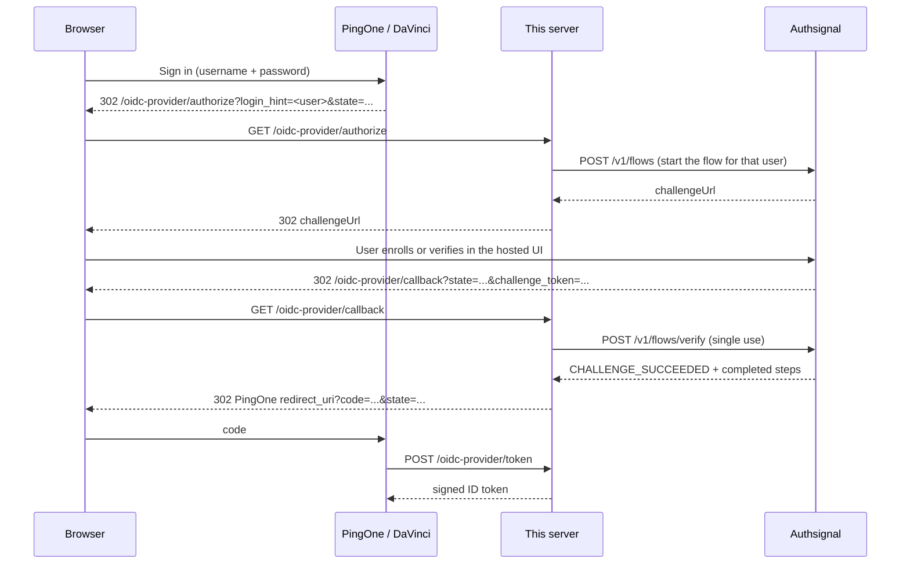
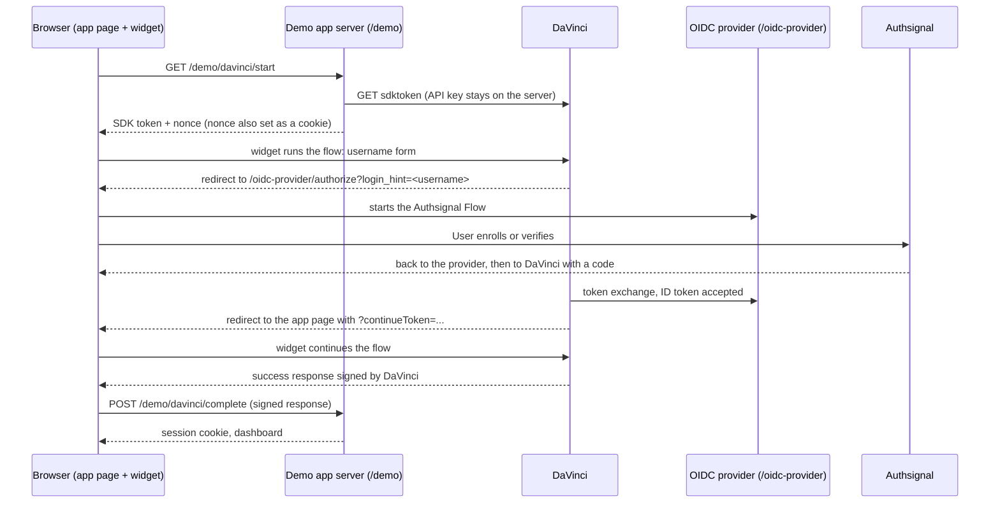

# Authsignal + PingOne integration

This server adds Authsignal MFA to PingOne and PingOne DaVinci. It is a small OpenID Connect provider: PingOne redirects the user to it after the first factor, it runs an Authsignal Flow, and it returns a signed ID token that says the user passed.

PingOne stays the identity provider. The customer's application does not change and never talks to Authsignal.

## How it works



The server needs to exist because Authsignal's own OIDC endpoints are not a plain authorization-code provider. The v1 endpoints need a server-side `/init-auth` call before the redirect, and the v2 endpoints only return an ID token by `form_post`. PingOne and DaVinci both expect the standard code flow, which is what this server gives them.

The user arrives in `login_hint`. PingOne sends the signed-in username when "Pass user context to provider" is on, and DaVinci sends whatever you put in the node's query parameters. That value becomes the Authsignal `userId`.

## What has been tested

The DaVinci path works end to end against a real Authsignal tenant: a DaVinci flow redirects to Authsignal with no button press, the user enrolls by email OTP, and DaVinci receives and accepts the ID token. The same round trip passes with the stand-in relying party in `test/rp-stub.mjs`.

The demo app (widget, Authsignal, back to the app, dashboard) works end to end against the same real tenant with email OTP, and with the stand-in Authsignal in `test/mock-authsignal.mjs`.

The PingOne authentication policy path has not been run yet. The steps below come from Ping's documentation and still need a live test.

## Quick start

```bash
npm install
cp .env.example .env
npm run dev
```

Fill in `.env` first. The provider turns on when `OIDC_PROVIDER_CLIENT_ID`, `OIDC_PROVIDER_CLIENT_SECRET` and `OIDC_PROVIDER_REDIRECT_URIS` are all set.

PingOne only accepts HTTPS endpoints, so for local work put a tunnel in front of port 3000 and set `APP_BASE_URL` to the tunnel URL. `APP_BASE_URL` is also the token issuer, so the connector in PingOne has to be updated whenever the URL changes.

```bash
cloudflared tunnel --url http://localhost:3000
```

## Authsignal setup

Create an action of type Flows in the Authsignal portal and publish it. The code defaults to `pingone-mfa` and can be changed with `AUTHSIGNAL_FLOW_ACTION_CODE`.

The flow has to cope with users who have no authenticator yet. A plain Verification step fails straight away for them, so branch first:

```
Start
  Rule "User not enrolled" (number of enrolled authenticators is 0)
    Yes: Enrollment step (required), then Complete
    No:  Verification step, then Complete
```

The server reports MFA only when the flow completes at least one enrollment or verification step. A flow that reaches Complete without one is returned to PingOne as `access_denied`.

## DaVinci setup

1. In DaVinci, add a connector of type "OIDC & OAuth IdP".
2. On the General tab set Auth Type to OpenId, then fill in the endpoints from `{APP_BASE_URL}/.well-known/openid-configuration`: issuer, authorization, token and user info.
3. Set App ID to `OIDC_PROVIDER_CLIENT_ID`, Client Secret to `OIDC_PROVIDER_CLIENT_SECRET`, Scope to `openid`, and turn on Use State.
4. Copy the connector's Redirect URL into `OIDC_PROVIDER_REDIRECT_URIS` and restart the server. It looks like `https://auth.pingone.com/<envId>/davinci/oauth2/callback`.
5. On the Attribute Mapping tab map `sub` to `username`. DaVinci refuses to run the connector without a username mapping.
6. In your flow, add the connector with the Sign On capability. Add a query parameter with key `login_hint` and the user's identifier as the value, and turn on Skip Button Press so the browser redirects without a click.
7. Branch on the node's result. A failed or abandoned challenge comes back as an OAuth error, not as a successful sign-on.

### Ready-made flows

`davinci/` has two flows built on these steps, as importable JSON with the environment IDs replaced by placeholders.

| File | What it does |
|---|---|
| `pingone-signon-authsignal-mfa.template.json` | Ping's sign-on template (PingOne password, registration, recovery) with an Authsignal step after the password check. This is the MFA setup. It needs PingOne SSO users in the environment. |
| `authsignal-passwordless.template.json` | Asks for a username, hands the user to Authsignal, and ends with a success response that carries the `username`. Authsignal is the only factor, so anyone who enters a new username can enrol it. Use it for demos and for environments without a user directory. The demo app below uses it. |

The two `build_*.py` scripts regenerate the files from DaVinci exports. After importing a flow, right-click the Authsignal node and choose Change Linked Connector, because DaVinci points imported nodes at the first connection of the same type it finds, which may not be the one you configured.

## Demo app

The server also hosts a small application at `/` that signs in the way a customer's app would. It embeds the DaVinci widget: the flow's form renders inside the app's own page, the browser goes to Authsignal and comes back to the app, and the app opens its dashboard. The user never sees a DaVinci-hosted page.



### Why the widget and not a redirect

A DaVinci Application has OIDC endpoints of its own (`.../davinci/policy/<policyId>/authorize`), but on their own they do not send the browser back to the app. The flow runs and then stops on a DaVinci page: "Screen type is not supported" after an external redirect, a blank page otherwise. Ping documents the redirect launch only through a PingOne application, with the flow ending in the PingOne Authentication connector, which signs in a PingOne directory user. The widget needs only the DaVinci Application, so it is the method that works in a DaVinci-only environment.

### Set up

1. In DaVinci go to Applications, add an application and open it. Copy the Company ID and API Key from the General tab.
2. On the Flow Policy tab add a policy, pick the passwordless flow at Latest Version, and give it a weight of 100. Copy the Policy ID.
3. Open the "OIDC & OAuth IdP" connection that points at this server and set Application Return To URL to `{APP_BASE_URL}/`. DaVinci sends the browser there with a `continueToken` after Authsignal. The setting belongs to the connection, so flows that use the same connection on a DaVinci-hosted page will also return to the app; use a separate connection for those.
4. In the flow, open the final Send Success JSON Response node and turn on Signed Response. Set Validity to a short time such as `120000` (two minutes).
5. In the flow's Input Schema add a required String parameter named `nonce`. Leave Return Request Parameters on in the success node so the nonce comes back in the signed response.
6. Save and deploy the flow, then put the values from steps 1 and 2 into the `DAVINCI_*` variables in `.env`.

### What the server trusts

The widget hands the flow's result to JavaScript in the page, so the page could claim anything. The server accepts only the `signedResponse` JWT and checks:

- the signature, against the environment's keys at `https://auth.pingone.com/<envId>/davinci/.well-known/jwks.json`, and the expiry
- `usage` is `flowResponse` and `companyId` is this environment (other tokens signed with the same keys, such as the SDK token, are refused)
- `flowId`, when `DAVINCI_FLOW_ID` is set
- `parameters.nonce` equals the nonce in this browser's signed cookie
- the interaction has not been used for a session before

The username comes from the signed `additionalProperties.username`. It is the value the flow sent to Authsignal as `login_hint`, so it is also the Authsignal user ID. The dashboard shows it with the authenticators the user has in Authsignal, and Manage Authenticators opens the Authsignal settings page for that user.

Two details that cost time: the widget must run with `includeHttpCredentials: false`, because DaVinci answers its calls with `Access-Control-Allow-Origin: *` and browsers refuse that for requests carrying cookies. And the sign-in page needs a looser Content Security Policy than the rest of the app (Ping's asset host, inline script and `eval` for the flow's Custom HTML nodes); the server applies it to that page only.

## PingOne authentication policy setup (not yet tested)

1. Go to Integrations > External IdPs and add an OpenID Connect provider.
2. Enter the client ID and secret, then paste `{APP_BASE_URL}/.well-known/openid-configuration` as the Discovery Document URI and choose Use Discovery Document.
3. Set Token Endpoint Authentication Method to Client Secret Basic and Requested Scopes to `openid`. PKCE can stay on; the server supports S256.
4. Copy the Callback URL PingOne shows into `OIDC_PROVIDER_REDIRECT_URIS` and restart the server.
5. Go to Authentication > Authentication and edit the policy. After the Login step, add a step of type External identity provider and pick the new provider.
6. Turn on "Pass user context to provider" so PingOne sends the username as `login_hint`.

Two things to confirm on the first live run: what PingOne puts in `login_hint` for a user who is not yet linked, and that PingOne links the returned `sub` to the user who signed in.

## Endpoints

| Path | Purpose |
|---|---|
| `GET /.well-known/openid-configuration` | Discovery document |
| `GET /oidc-provider/authorize` | Starts the Authsignal Flow. Requires `login_hint` and `state`. |
| `GET /oidc-provider/callback` | Return URL for the Authsignal hosted UI |
| `POST /oidc-provider/token` | Exchanges the code for an ID token (`client_secret_basic` or `client_secret_post`) |
| `GET /oidc-provider/userinfo` | Returns `sub` for a valid access token |
| `GET /oidc-provider/jwks` | Public signing key |

The ID token carries `sub`, `nonce`, `auth_time`, `amr` and `authsignal_verification_methods`. If the request included `acr_values`, the first value is echoed back as `acr`.

## Configuration

| Variable | Notes |
|---|---|
| `AUTHSIGNAL_SECRET`, `AUTHSIGNAL_TENANT_ID` | Server API secret and tenant ID |
| `AUTHSIGNAL_REGION` | `us`, `eu`, `au` or `ca` |
| `AUTHSIGNAL_FLOW_ACTION_CODE` | Flow action to run. Default `pingone-mfa`. |
| `APP_BASE_URL` | Public URL of this server. Also the token issuer. |
| `OIDC_PROVIDER_CLIENT_ID`, `OIDC_PROVIDER_CLIENT_SECRET` | Credentials PingOne uses at the token endpoint. The secret must be at least 32 bytes. |
| `OIDC_PROVIDER_REDIRECT_URIS` | Comma-separated callback URLs, matched exactly |
| `OIDC_PROVIDER_SIGNING_KEY_JWK` | Private RSA JWK for signing ID tokens. Required in production. |
| `TRUST_PROXY` | Set to `1` behind a tunnel or load balancer |
| `DAVINCI_ENVIRONMENT_ID`, `DAVINCI_API_KEY`, `DAVINCI_POLICY_ID` | DaVinci application the demo app signs in through. The demo app uses the widget when all three are set. |
| `DAVINCI_FLOW_ID` | Optional. Only accept signed responses from this flow. |
| `PINGONE_*` | Used only by the legacy demo app, but must still be present |

In development the signing key is generated once and kept in `.oidc-signing-key.json`, which is gitignored. PingOne caches the JWKS, so the key has to survive restarts.

## Tests

```bash
npm run typecheck
npm run test:e2e
```

`test:e2e` starts the server against a mock Authsignal API and runs the whole code flow, including the rejection cases: wrong client, unregistered redirect URI, bad PKCE verifier, replayed code, replayed callback, and a flow that finishes without a verification step.

To exercise the DaVinci wiring without a tenant, an authenticator or a one-time code, run the stand-in Authsignal, which approves every challenge, and point the server at it. Never do this on a deployed server.

```bash
node test/mock-authsignal.mjs
AUTHSIGNAL_API_URL=http://localhost:4621/v1 npm run dev
```

For a manual run against a real tenant without PingOne, add `http://localhost:3999/cb` to `OIDC_PROVIDER_REDIRECT_URIS` and start the stand-in relying party. It exchanges the code and prints the verified claims.

```bash
node --env-file=.env test/rp-stub.mjs
```

## Security notes

Redirect URIs are matched exactly against the configured list, and the server never redirects to an unknown client. Authorization codes last 60 seconds and work once. The Authsignal challenge token is verified server-side and Authsignal invalidates it on first use.

Each sign-in is bound to the browser that started it with a signed, HTTP-only cookie that lasts 30 minutes. A callback that arrives without that cookie, from another browser or after it has expired, sends the relying party an `access_denied` error and never a code.

Sessions, codes and access tokens are held in memory. Running more than one instance needs a shared store such as Redis.

## Legacy demo app

Without the `DAVINCI_*` variables the demo app falls back to its original mode: PingOne login, then the `/oidc/initiate` bridge. That mode uses Authsignal's classic actions and is documented in [docs/legacy-demo.md](docs/legacy-demo.md).
